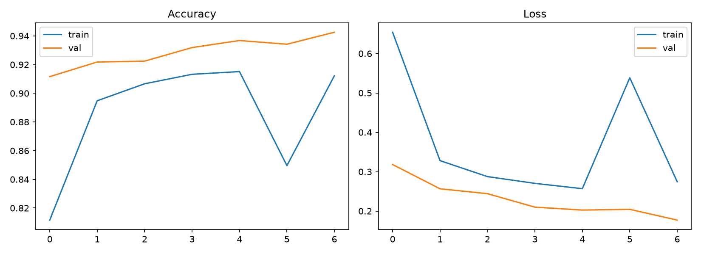
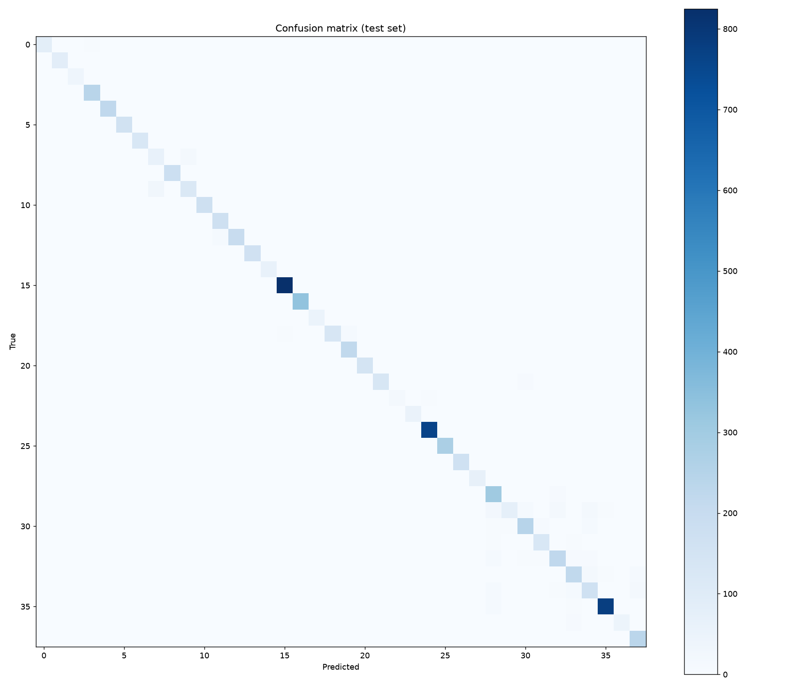

# Plant Doctor - Plant Disease Detection with Mobile Deployment

Detects plant diseases from leaf photos with a deep-learning image classifier (MobileNetV2 transfer learning),
converts it to TensorFlow Lite, and provides an Android app and a FastAPI backend that return the disease name,
confidence, and basic treatment and prevention advice for farmers.

**Stack:** Python, TensorFlow/Keras, CNN, OpenCV, TensorFlow Lite, FastAPI, Android Studio (Kotlin)

## Results

Dataset: PlantVillage (color), 54,297 images, 38 classes (14 crops), stratified 70/15/15 train/validation/test split.

| Model | Test accuracy | Size |
|---|---|---|
| MobileNetV2 (Keras), 8,145 test images | **94.01%** | 10.2 MB |
| MobileNetV2 (TFLite, dynamic-range quantised), 2,000-image test sample | **93.6%** | 2.56 MB |

Macro-average F1 on the test set is 0.923. The weakest classes are visually similar tomato and corn diseases
(Tomato Early Blight recall 0.47, Corn Cercospora leaf spot F1 0.73, Tomato Target Spot F1 0.77).
Full per-class metrics are in [`docs/classification_report.txt`](docs/classification_report.txt).




## Architecture
```
PlantVillage images -> ml/train.py (augmentation + MobileNetV2) -> plant_disease.keras
                    -> ml/convert_tflite.py (quantised)         -> plant_disease.tflite + labels.txt
                         |-> android/app/src/main/assets  (on-device inference, works offline)
                         |-> backend/  (FastAPI + OpenCV leaf check, optional server inference)
treatments.json (38 classes): disease name -> treatment / prevention text
```

## Setup (Python 3.10-3.12; TensorFlow does not yet support the newest Python versions)
```bash
python -m venv venv
venv\Scripts\activate          # Mac/Linux: source venv/bin/activate
pip install -r requirements.txt
```

## 1. Train
Download PlantVillage from Kaggle (`abdallahalidev/plantvillage-dataset`) and point `--data_dir` at its `color` folder:
```bash
python ml/train.py --data_dir "path/to/plantvillage dataset/color" --model mobilenet --epochs 5 --finetune_epochs 2
```
Outputs go to `artifacts/` (model, labels, training curves, confusion matrix, classification report, metrics).

## 2. Convert to TFLite and check accuracy
```bash
python ml/convert_tflite.py     # also copies the model and labels into android assets and backend/
python ml/eval_tflite.py --data_dir "path/to/plantvillage dataset/color" --n 2000
```

## 3. Backend (FastAPI)
```bash
cd backend
uvicorn app:app --reload
```
Open http://127.0.0.1:8000/docs, choose **POST /predict**, upload a leaf image. The response contains the plant,
condition, confidence, treatment, prevention, top-3 predictions, and a warning for low-confidence or non-leaf images
(OpenCV HSV leaf check).

## 4. Android app
1. Open the `android/` folder in Android Studio and let Gradle sync.
2. Check that `app/src/main/assets/` contains `plant_disease.tflite`, `labels.txt` and `treatments.json`.
3. Run on a phone or emulator, or build an APK with `.\gradlew assembleDebug`
   (output: `android/app/build/outputs/apk/debug/app-debug.apk`).

The app takes a photo or gallery image, runs the TFLite model on the device, and shows the disease, confidence,
treatment and prevention. If the model fails to load, the error is shown on screen.

## Limitations
- PlantVillage images are lab-style (single leaf, plain background), so accuracy on real field photos will be lower.
  Future work: add field datasets such as PlantDoc and stronger augmentation.
- Treatment text is general guidance only. Confirm with a local agriculture officer before spraying.


## render url 
Live API: https://plant-doctor-li84.onrender.com/docs


## apk drive link 
https://drive.google.com/file/d/11SwaFQvLNcVsFfPq7IEeEclRbPsQ7BTt/view?usp=sharing
